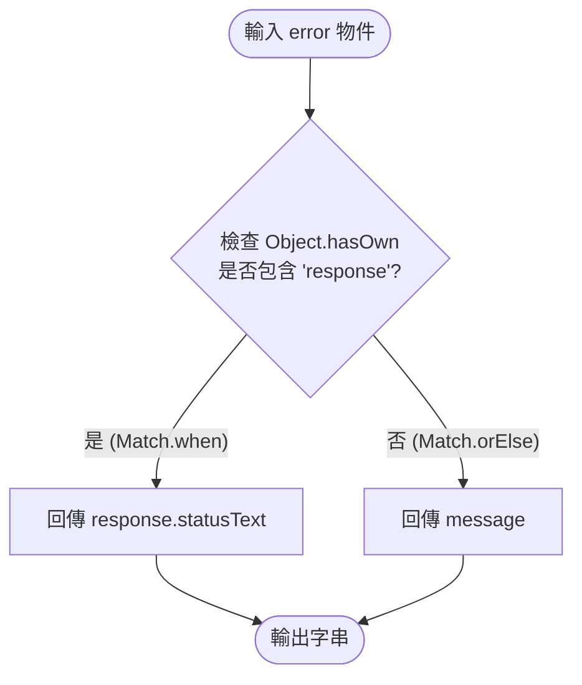

# 錯誤處理的進化：從 if/else 到 Effect.Match 模式匹配

在開發應用程式時，我們經常需要針對不同類型的錯誤物件進行轉換。本教學將透過三個階段，帶你了解如何從傳統的 `if/else` 寫法，進化到使用 Effect TS 強大的 `Match` 模組，並探討其帶來的優勢。

---

## 1. 傳統寫法：使用 `if/else` (`if.txt`)

最直覺的處理方式是使用標準的 JavaScript `if/else` 條件判斷：

```typescript
const transformError = (error: object) => {
  if (Object.hasOwn(error, "response")) {
    return (error as AxiosError).response!.statusText;
  } else {
    return (error as AxiosError).message;
  }
}
```

**說明：**
這段程式碼直接檢查傳入的 `error` 物件是否帶有 `response` 屬性。如果有，就當作是 Axios 錯誤並提取 `statusText`；否則就回傳一般的錯誤 `message`。雖然簡單易懂，但當條件變多時，程式碼容易變得冗長且難以維護（也就是常見的 if/else 地獄）。

---

## 2. 導入 Effect.Match：宣告式的匹配模式 (`when.txt`)

Effect TS 提供了 `Match` 模組，讓我們可以透過「模式匹配」的概念來重構這段邏輯：

```typescript
const transformError = (error: object) =>
  Match.value(error).pipe(
    Match.when(
      (value) => Object.hasOwn(value, "response"),
      (value) => (value as AxiosError).response!.statusText,
    ),
    Match.orElse((value) => (value as AxiosError).message)
  );
```

**說明：**
這裡我們將 `error` 放入 `Match.value()` 中，接著使用 `.pipe()` 建立一條處理管線：
*   `Match.when(條件, 結果)`：定義了匹配的條件。如果 `error` 擁有 `response` 屬性，就執行第二個函式回傳 `statusText`。
*   `Match.orElse(預設結果)`：就像是 `switch` 語句裡的 `default` 或 `if/else` 的 `else`，用來處理所有未被 `when` 捕捉到的情況。

這讓程式碼從「指令式 (Imperative)」轉變為「宣告式 (Declarative)」，我們更專注於定義「規則」，而不是控制「流程」。

---

## 3. 進階優勢：邏輯抽離與模組化 (`when2.txt`)

`Match.when` 最強大的特點之一是：**匹配規則本身是純值（Pure Values），可以被抽離出來獨立存放與組合**。

```typescript
// 1. 抽離規則 A：如果有 response, 則回傳 statusText
const hasResponseAndstatusText = Match.when(
  (value:object) => Object.hasOwn(value, "response"),
  (value:object) => (value as AxiosError).response!.statusText,
)
  
// 2. 抽離規則 B：如果沒有 response，則回傳錯誤訊息
const elseReturnMessage = Match.orElse((value) => (value as AxiosError).message)

// 3. 將抽離的邏輯組合起來
const transformError = (error: object) =>
  Match.value(error).pipe(
    hasResponseAndstatusText, // 套用規則 A
    elseReturnMessage         // 套用規則 B (Fallback)
  );
```

**說明：**
這段程式碼將原本寫死在 `pipe` 裡面的邏輯，抽離成獨立的變數 `hasResponseAndstatusText` 與 `elseReturnMessage`。我們將複雜的判斷邏輯拆解成了樂高積木，可以隨意組裝。

---

## 流程圖解析

無論你使用上述哪一種寫法，其背後的核心處理流程都是相同的：



---

## 總結：使用 `Effect.Match` 的好處

從 `when2.txt` 的範例中，我們可以清楚看到使用 `Effect.Match` 帶來的三大好處：

1. **高重用性 (Reusability)**
   你可以將常見的匹配邏輯（例如 `hasResponseAndstatusText`）抽離並放入一個共用的 Utils 檔案中。如果在其他地方也需要解析類似的錯誤，直接 `import` 這個規則即可，不需重複撰寫 `if` 判斷式。
2. **極佳的可讀性 (Readability)**
   主函式 `transformError` 變得非常乾淨，就像是在讀一句流暢的英文：「處理這個值，套用 A 規則，不然就套用 B 規則」。它將「做什麼 (What)」與「如何做 (How)」完美分開。
3. **安全與擴展性 (Safety & Scalability)**
   在型別系統的輔助下，當未來需要增加處理新的錯誤類型（例如 GraphQL 錯誤、特定狀態碼錯誤）時，只需再新增一條 `Match.when` 規則並插入 `pipe` 中，不用擔心破壞原有的 `if/else` 巢狀結構。